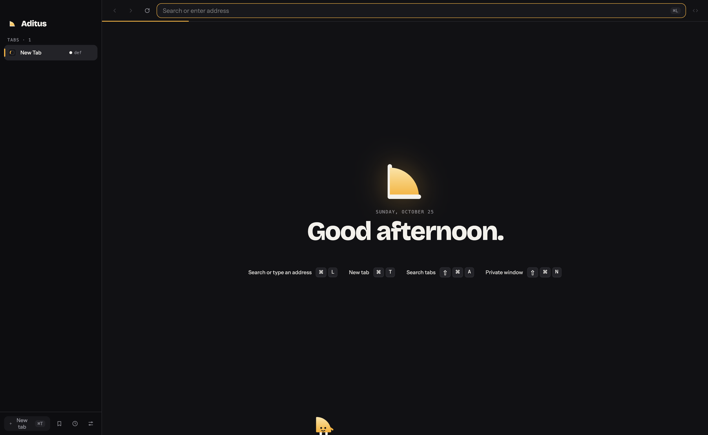
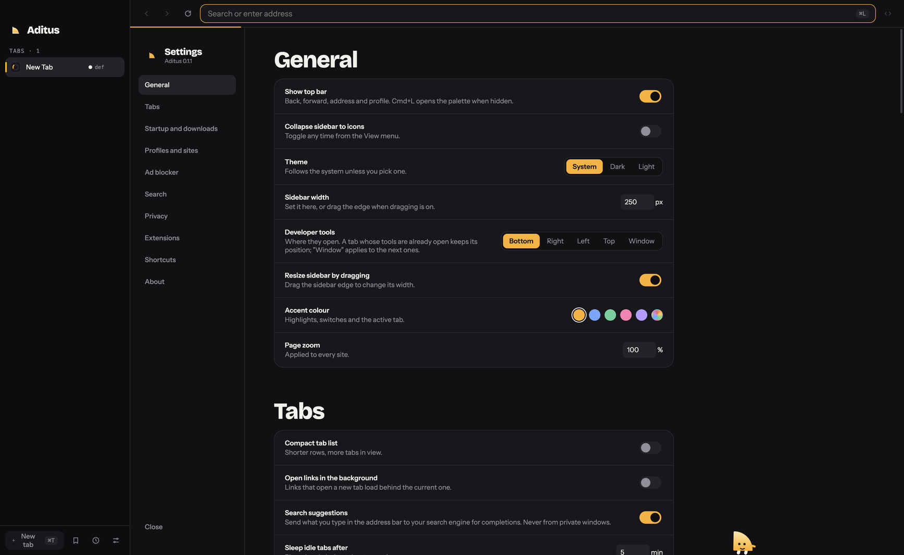
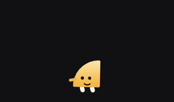
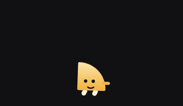

# Aditus

A lightweight, open-source desktop browser with a vertical tab sidebar and per-site account isolation.

> Status: early, daily-usable on macOS. Runs on Chromium (CEF). Only macOS is built and tested in CI; Windows and Linux are untested.

<p align="center"></p>

## The name

*Aditus* is Latin for "a way in": an approach, an entrance, access. It comes from *adire*, "to go toward". A browser is the door to the web, so that is what it is called.

## Run

```sh
cd ui && npm install && cd ..
# needs Rust, ninja, a prebuilt CEF in $CEF_PATH and bundle-cef-app (see backend/bundle-mac.sh)
backend/bundle-mac.sh            # debug Aditus.app in backend/target/bundle
backend/bundle-mac.sh release    # optimised
node scripts/smoke.mjs backend/target/bundle/Aditus.app/Contents/MacOS/aditus
```

Unsigned builds: right-click the app and choose Open (or `xattr -cr Aditus.app`). Release builds ask for Keychain access once (Chromium cookie key); a signed build keeps the answer.

Shortcuts: Cmd/Ctrl+L address bar, Cmd/Ctrl+F find, Cmd/Ctrl+Shift+A search tabs. With a link selected in the page or text selected in the address bar, Cmd/Ctrl+T opens it in a new tab and Cmd/Ctrl+Shift+N in a private window.

## Layout

```
ui/        Svelte 5 + Vite front end: sidebar, address bar, palette, settings (src/), static pages (public/)
backend/   Rust: CEF engine, tabs, profiles, adblock, storage, menus (src/), bundling scripts, app icons and resources
scripts/   smoke test
```

The UI is built to `ui/dist` and served inside the app as `aditus://app/...`; the backend talks to it over `cefQuery` commands and state events.

## Why

Most browsers spend screen space and memory on things I don't use. Aditus aims for:

- A minimal UI with the tab bar on the side, collapsible to an icon strip.
- Small binary, fast startup, low memory.
- Different accounts per website in the same window. Example: Google Photos on account A, YouTube on account B, side by side, without separate windows.
- A built-in ad blocker, plus Chrome extensions when you want more.

## How it works

- **Engine:** Chromium through [CEF](https://bitbucket.org/chromiumembedded/cef) (raw `cef-rs`, no Tauri). Same engine on every OS. The prebuilt CEF has no H.264/AAC and no Widevine DRM: VP9/Opus work, Netflix-style DRM and some video sites don't.
- **Profiles:** a profile is an isolated storage area (cookies, localStorage, logins). Every tab runs in one profile. You map hosts to profiles (`photos.google.com` → A, `youtube.com` → B). Navigating a tab to a host mapped to another profile swaps the tab to that profile's browser, with an undo toast. Redirects, login flows, and OAuth popups never swap.
- **Ad blocker:** [`adblock-rust`](https://github.com/brave/adblock-rust) with EasyList, EasyPrivacy, and uBlock filters, refreshed in the background. Per-site allowlist from the top bar.
- **Memory:** background tabs idle for 10 minutes (configurable) are discarded and reloaded on click. Pinned and audio-playing tabs are exempt.
- **Extensions:** Settings → Extensions installs Manifest V3 extensions from a Chrome Web Store link or id. Content scripts, background workers and declarativeNetRequest work (Dark Reader tested). They are shared by all profiles, don't run in private windows. They update themselves every 6 hours (new code runs after a restart) unless a new version asks for more permissions. Popups that need the current tab (password-manager autofill) don't work yet.
- **Updates:** the app checks GitHub releases and, on macOS, installs a new version after a click. It verifies GitHub's sha256 digest, the code signature and the bundle id first. Chromium security fixes arrive by bumping the pinned `cef` crate; a weekly workflow opens that PR.

## Screenshots

<p align="center"></p>

The sidebar lists tabs with the profile each one runs in (`def`), the address bar sits on top, and the footer holds new tab, bookmarks, history and settings.

## Meet Swing

Swing is the small mascot that lives in the browser. It wanders along the bottom of the new tab page, perches in the sidebar footer while a page is open, and reacts to what you do.

<p align="center"> </p>

- **Moods:** it walks, follows your pointer, waves, jumps, spins, dances, stretches, sits, sneezes, trips, naps. Its eyes track the cursor.
- **Messages:** click it for a line (`Where to?`, `Try ⌘L, it is fast.`, `Tab hoarder detected.`, `No ads here. Ssh.`). Get close and it jumps with `Whoa!`.
- **Reactions:** when a background tab is put to sleep it tucks it in (`Nap time, tab.`) and sometimes trips over it (`Whoops!`, `Ow.`). When open tabs add up to more than 4 GB it gets angry (`So much RAM!!`).
- **Private windows:** it puts on shades and whispers (`Shh. Nobody saw.`, `Incognito. Very mysterious.`).

## Features

Address bar with autocomplete (history, search suggestions), tabs in a sidebar (pinning, grouping, search, idle discard), multiple windows and private windows, session restore, per-site profiles, ad blocker, bookmarks, history, downloads, find in page, reader mode, saved passwords, Chrome extensions, native DevTools, a Cmd/Ctrl+L palette, and Swing, a small mascot that lives in the sidebar.

Not here: sync, mobile.

## Platforms

macOS 14+ (tested), Windows, Linux (untested).

## Stack

Rust, CEF 156 via `cef-rs` (Views framework), Svelte 5, SQLite for history and downloads, TOML for config.

## Performance (macOS, Apple silicon, measured once)

- Speedometer 3.1: 52.3 (Aditus debug build, ad blocker on) vs 50.7 (Chrome 155).
- 10 loaded tabs, summed RSS: ~4.2 GB / 23 processes vs Chrome ~4.7 GB / 27 processes.
- Window up in ~135-260 ms warm (release).

## Known limits

- Ad blocking is good, not uBlock Origin parity.
- No H.264/AAC, no Widevine (needs a custom CEF build).
- Extensions: updates need a restart, no tab-aware popups, shared across profiles (Chromium loads them once per process; per-profile isolation would need a separate engine context per profile, not done).
- Release builds are signed and notarized only when signing secrets are set in CI; otherwise unsigned (right-click → Open).

## Release signing

The in-app updater only installs a release zip whose detached ed25519 signature (`<zip>.sig`, over the zip's sha256 hex) verifies against `UPDATE_PUBKEY` in `backend/src/update.rs`. The shipped value is a placeholder, so installing updates is refused until you set it:

```sh
# one-time: prints the public key to paste into UPDATE_PUBKEY; store key.pem as the GitHub secret UPDATE_SIGNING_KEY
openssl genpkey -algorithm ed25519 -out key.pem && openssl pkey -in key.pem -pubout -outform DER | tail -c 32 | base64
```

`release.yml` signs with that secret and fails the release if it is missing. It needs OpenSSL 3 (macOS's LibreSSL can't sign ed25519). The Developer ID Team ID is still pinned when the installed app has one.

## License

GPL-3.0. See [LICENSE](LICENSE).
